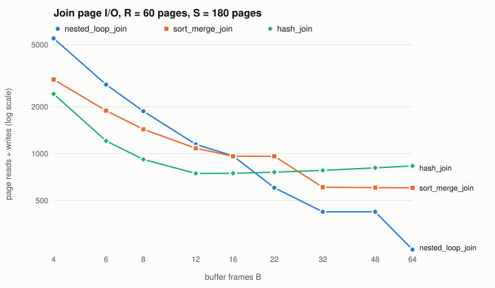
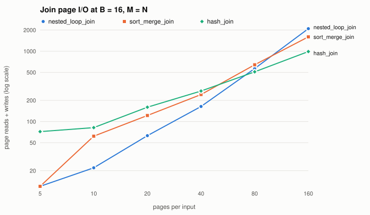

# Module 2 report: execution engine

**Machine:** 12th Gen Intel(R) Core(TM) i5-12400F - 2.50 GHz, 16 GB RAM, NVIDIA GeForce RTX 3060 Ti (8Gb) - Windows 10 Pro 22H2
**Language:** Python 3.11.5

All numbers come from
`python scripts/measure_m2.py WORK_DIR`, which builds its own tables and prints these tables;
reruns print the same numbers. Relations are `R<n>(a, b, pad)` and `S<n>(b, c, pad)` with 160-byte
records, 24 per page, n data pages each; `b` gives every R tuple about two S matches. M and N are
the inputs' data pages. Each table also has one directory page, which every scan reads once.

## 1. The three joins against their formulas

| join | M = N | B | reads | writes | measured I/O | formula | measured - formula |
|---|---|---|---|---|---|---|---|
| nested_loop_join | 20 | 4 | 231 | 0 | 231 | 220 | +11 |
| nested_loop_join | 20 | 16 | 63 | 0 | 63 | 60 | +3 |
| nested_loop_join | 20 | 64 | 42 | 0 | 42 | 40 | +2 |
| nested_loop_join | 20 | 256 | 42 | 0 | 42 | 40 | +2 |
| nested_loop_join | 60 | 4 | 1891 | 0 | 1891 | 1860 | +31 |
| nested_loop_join | 60 | 16 | 366 | 0 | 366 | 360 | +6 |
| nested_loop_join | 60 | 64 | 122 | 0 | 122 | 120 | +2 |
| nested_loop_join | 60 | 256 | 122 | 0 | 122 | 120 | +2 |
| nested_loop_join | 180 | 4 | 16471 | 0 | 16471 | 16380 | +91 |
| nested_loop_join | 180 | 16 | 2534 | 0 | 2534 | 2520 | +14 |
| nested_loop_join | 180 | 64 | 724 | 0 | 724 | 720 | +4 |
| nested_loop_join | 180 | 256 | 362 | 0 | 362 | 360 | +2 |
| sort_merge_join | 20 | 4 | 172 | 130 | 302 | 240 | +62 |
| sort_merge_join | 20 | 16 | 82 | 40 | 122 | 160 | -38 |
| sort_merge_join | 20 | 64 | 42 | 0 | 42 | 80 | -38 |
| sort_merge_join | 20 | 256 | 42 | 0 | 42 | 80 | -38 |
| sort_merge_join | 60 | 4 | 652 | 530 | 1182 | 960 | +222 |
| sort_merge_join | 60 | 16 | 242 | 120 | 362 | 480 | -118 |
| sort_merge_join | 60 | 64 | 242 | 120 | 362 | 240 | +122 |
| sort_merge_join | 60 | 256 | 122 | 0 | 122 | 240 | -118 |
| sort_merge_join | 180 | 4 | 2444 | 2082 | 4526 | 3600 | +926 |
| sort_merge_join | 180 | 16 | 1082 | 720 | 1802 | 1440 | +362 |
| sort_merge_join | 180 | 64 | 722 | 360 | 1082 | 1440 | -358 |
| sort_merge_join | 180 | 256 | 722 | 360 | 1082 | 720 | +362 |
| hash_join | 20 | 4 | 147 | 42 | 189 | 120 | +69 |
| hash_join | 20 | 16 | 101 | 59 | 160 | 120 | +40 |
| hash_join | 20 | 64 | 166 | 125 | 291 | 120 | +171 |
| hash_join | 20 | 256 | 378 | 375 | 753 | 120 | +633 |
| hash_join | 60 | 4 | 825 | 123 | 948 | 360 | +588 |
| hash_join | 60 | 16 | 255 | 133 | 388 | 360 | +28 |
| hash_join | 60 | 64 | 297 | 175 | 472 | 360 | +112 |
| hash_join | 60 | 256 | 612 | 497 | 1109 | 360 | +749 |
| hash_join | 180 | 4 | 6092 | 363 | 6455 | 1080 | +5375 |
| hash_join | 180 | 16 | 738 | 376 | 1114 | 1080 | +34 |
| hash_join | 180 | 64 | 783 | 421 | 1204 | 1080 | +124 |
| hash_join | 180 | 256 | 918 | 556 | 1474 | 1080 | +394 |

Formulas: nested loop `M + ceil(M/(B-2))·N`; sort-merge `sort(M) + sort(N) + M + N` with
`sort(M) = 2M(passes-1) + M`; hash `3(M + N)`. Every join produced the same output (990, 2920 and
8494 rows) and the nested loop counted exactly |R|·|S| comparisons in every row (230400, 2073600,
18662400), whatever B was.

**Block nested loop matches the formula to the page, once directory pages are counted.** The gap is
always `1 + ceil(M/(B-2))`: one directory page for the outer scan plus one per rescan of the inner.
For M = 180, B = 4 that is `1 + 90 = 91`. The formula counts data pages only, and a heap file
cannot be scanned without reading its directory.

**Sort-merge differs in both directions, for three reasons, each visible in the rows.**

1. *The final merge streams into the join.* The formula's `+ M + N` reads the sorted inputs once
   more, but here each sort's last merge pass feeds the join directly, so those reads never happen.
   Where nothing else interferes this is exactly −(M + N) plus 2 directory pages: M = 20, B = 16
   gives 160 − 40 + 2 = 122, and M = 180, B = 64 gives 1440 − 360 + 2 = 1082. When both inputs fit
   in memory (M = 20, B = 64 and 256, M = 60, B = 256) nothing is written and the I/O is just the two
   scans, 42 and 122.
2. *The two final merges share the buffer.* They stream at the same time, so each sort gets about
   half of B for its final merge. A 60-page input at B = 64 would fit in memory alone but not in
   its half (31 frames), so it is written once and read back: measured 362 against 240. The +122
   is one write of each input (120), which the formula does not count, plus the 2 directory pages;
   reading the runs back is the formula's own M + N. M = 180 at B = 256 is the same effect (+362). The
   formula assumes each sort has all of B, which no two concurrent sorts can have.
3. *Runs are B − 1 pages and the final fan-in is small at tiny B.* At B = 4 the left sort may keep
   only one frame for its final merge, so it must merge down to a single run, one pass more than the
   formula's (+62, +222, +926). DESIGN_M2 explains the B − 1 run size.

**Hash join agrees in the middle and departs at both ends, and the ends are the interesting part.**

- At B = 16 the gap is +28 to +40: one partly filled last page per partition and side (15
  partitions × 2 sides × a write and a read in the worst case), plus 2 directory pages.
- At B = 4 there are only 3 partitions. A 60-page input then gives 20-page partitions against a
  build limit of B − 1 = 3 pages, so every partition overflows and falls back to a block nested loop
  on its pair of files (comparisons jump from 2920 to 692278). The formula `3(M + N)` silently
  assumes `M / (B − 1) <= B − 1`, that is B ≥ √M. At M = 180, B = 4 that is badly false, and the
  join costs 6455 instead of 1080.
- At B = 256 it is the opposite: 255 partitions for 20-page inputs leave about 2 tuples in each,
  and every non-empty partition still costs a full page write and read: 753 instead of 120. The
  handout fixes P = B − 1, and the executor uses it when both inputs are pipelines, as here; over
  a blocking input it is B less that input's streaming share (DESIGN_M2), so a hash join over a sort
  at B = 16 uses 8. Choosing `P = min(B − 1, ceil(M / (B − 2)) · 2)` from the optimizer's
  estimate of M would remove this. It is left as is, because the executor does not know M for an
  intermediate input.

## 2. External sort: passes

| N pages | B | measured passes | handout formula | ours: 1+ceil(log(ceil(N/(B-1)))/log(B-1)) | reads | writes | peak frames |
|---|---|---|---|---|---|---|---|
| 8 | 3 | 3 | 3 | 3 | 25 | 16 | 3 |
| 60 | 4 | 4 | 4 | 4 | 235 | 174 | 4 |
| 80 = 20B | 4 | 4 | 4 | 4 | 321 | 240 | 4 |
| 100 | 5 | 4 | 4 | 4 | 397 | 296 | 5 |
| 180 | 8 | 3 | 3 | 3 | 541 | 360 | 8 |
| 320 = 20B | 16 | 3 | 3 | 3 | 961 | 640 | 16 |
| 500 | 10 | 3 | 3 | 3 | 1501 | 1000 | 10 |
| 500 | 64 | 2 | 2 | 2 | 1001 | 500 | 64 |

The measured passes equal the handout's formula in all eight cases, including the two at N = 20 × B.
Pass 0 here makes runs of B − 1 pages (one frame holds the input page being copied), so the run
count is `ceil(N/(B−1))` rather than `ceil(N/B)`. The two formulas differ only when that pushes the
run count across a power of B − 1, and none of these sizes does. N = 10, B = 4 would: 3 runs by the
handout, 4 here, so 3 passes against 2. Reads and writes follow from the passes. For N = 80, B = 4:
pass 0 reads 80 + 1 (the scan) and writes 80; two middle passes read and write 80 each; the final
pass reads 80. That totals 321 and 240.

## 3. Crossover

R60 (60 pages) joined with S180 (180 pages):

| B | nested_loop_join | sort_merge_join | hash_join | cheapest |
|---|---|---|---|---|
| 4 | 5491 | 2989 | 2417 | hash_join |
| 6 | 2776 | 1886 | 1207 | hash_join |
| 8 | 1871 | 1434 | 918 | hash_join |
| 12 | 1147 | 1082 | 746 | hash_join |
| 16 | 966 | 962 | 748 | hash_join |
| 22 | 604 | 961 | 760 | nested_loop_join |
| 32 | 423 | 608 | 780 | nested_loop_join |
| 48 | 423 | 605 | 810 | nested_loop_join |
| 64 | 242 | 603 | 834 | nested_loop_join |

**The ranking changes between B = 16 and B = 22**, and the cause is the nested loop's number of
outer blocks, `ceil(60/(B−2))`.

- At B = 16 it is 5 blocks, so S is read 5 times (966). At B = 22 it drops to 3 blocks (604), below
  the hash join's roughly constant 3(M + N) ≈ 760.
- From B = 62 the whole outer fits in one block and the nested loop is just M + N (242).
- The hash join is cheapest whenever B is small, because its cost does not depend on B as long as
  partitions fit. It even rises slowly with B: more partitions mean more partly empty pages.
- Sort-merge sits between the two, dropping in steps where its sorts lose a pass (B = 32).

B = 16, both inputs the same size:

| M = N | nested_loop_join | sort_merge_join | hash_join | cheapest |
|---|---|---|---|---|
| 5 | 12 | 12 | 72 | nested_loop_join |
| 10 | 22 | 62 | 82 | nested_loop_join |
| 20 | 63 | 122 | 160 | nested_loop_join |
| 40 | 164 | 242 | 272 | nested_loop_join |
| 80 | 567 | 642 | 510 | hash_join |
| 160 | 2093 | 1602 | 990 | hash_join |

**The ranking changes between 40 and 80 pages.**

- The nested loop costs `M + ceil(M/14)·M`, quadratic once the outer needs more than one block.
- The hash join costs about 6M plus a fixed partitioning overhead: 15 partitions × 2 sides of
  mostly empty pages. That overhead is why it loses on tiny inputs (72 pages of I/O to join two
  5-page tables).
- At 40 pages the nested loop reads S three times and still wins (164 < 272). At 80 it reads it six
  times (567) and the hash join (510) takes over.

## 4. Skew: one key in 40 % of the rows on both sides

K1 and K2: 1440 rows each (60 pages); key 7 was drawn with probability 0.4, giving 564 and 563
rows. The rest are uniform. U1 and U2: the
same sizes with uniform keys. Hash join at B = 16 (15 partitions, build limit 15 pages).

| data | output rows | partition pages (left, right) | overflowing | reads | writes | I/O | comparisons |
|---|---|---|---|---|---|---|---|
| skewed | 318047 | (3,4) (3,4) (3,3) **(27,26)** (2,3) (2,3) (3,3) (3,3) (3,3) (3,3) (2,2) (3,3) (3,3) (3,3) (2,3) | 1 | 282 | 134 | 416 | 392886 |
| uniform | 1439 | (5,5) (4,4) (5,5) (5,5) (4,5) (4,4) (4,4) (5,5) (5,4) (4,4) (4,5) (4,5) (5,5) (5,4) (5,4) | 0 | 258 | 136 | 394 | 1439 |

**What happened to the partitions.** Every tuple with key 7 hashes to the same partition, which
received 27 left pages and 26 right pages against a build limit of 15. No hash function can split
equal keys, so repartitioning could not have helped. The other 14 partitions got the remaining 60 %
evenly, 2 to 3 pages each on the left and 2 to 4 on the right.

**What the code did.** That one pair of files fell back to a block nested loop: the 27-page build
side in blocks of 14 frames, so the 26-page probe side was read twice. The other partitions were
joined in memory as usual.

**What it cost.**

- The I/O rose only from 394 to 416 (+22 pages: the second read of the 26-page probe partition
  and the partitions' partial pages).
- The comparisons rose from 1439 to 392886, because the fallback tests every pair in the heavy
  partition. That is the 564 left and 563 right key-7 tuples, plus the ordinary tuples that
  happened to hash to the same partition on each side.
- The output is 318047 rows instead of 1439, and that is inherent: 564 × 563 = 317532 of them are
  key-7 pairs, which is what the join *means* on this data.

The I/O formula barely notices skew. The CPU cost and the output size are where skew hurts.

## 5. The budget

A sort of R80 (80 pages, 20 × B) at B = 4 completes: 1920 tuples, checked sorted, 4 passes,
321 reads, 240 writes. **The largest number of frames held at once was 4 of 4.**

This is known, not estimated. The buffer pool counts pinned frames plus frames reserved by operators
at every pin and every reservation, records the maximum (`peak_frames`), and raises an error rather
than going over B. During pass 0 the 4 frames are 1 pinned scan page plus a 3-frame run buffer. In
the merges they are 3 input frames plus 1 output frame.

`exec run` prints `peak_frames` for every plan. All 12 sample plans in `workload/plans/` run at
B = 4 with a peak of at most 4, and the test suite asserts `peak <= B` after every plan it runs
(`TestRandomPlans` runs random join, group_by and distinct trees at B = 4, 5 and 9 against a
reference evaluator).

## Checklist

- The sort example reproduces in its documented variant (25 reads including the directory page,
  16 writes, 3 passes; `test_sort_of_eight_pages_at_three_frames`).
- The duplicate key example returns four rows.
- All three joins return the same bag (tested at B = 4, 7, 32 and on random plans).
- Block nested loop reports exactly |R| × |S| comparisons (table above, and a test with a
  non-equality condition).
- Every plan runs at B = 4, including every sample plan.
- A join larger than both inputs completes (the skew join: 318047 rows from 1440 + 1440).
- An empty input through every operator returns cleanly, including group_by with and without keys
  (`test_empty_input_through_every_operator`).
- After any plan, no frame is pinned or reserved and no temp file remains (asserted after every
  plan in `tests/test_execution.py`).

## Sources and what they changed

- Graefe, *Volcano: An Extensible and Parallel Query Evaluation System*, IEEE TKDE 1994.
  Open/next/close with all blocking work in `open()` is the Volcano iterator. Its separation of
  memory between operators led to the two-number budget: an input's blocking work happens before
  its parent holds memory, so it can use all of it.
- Shapiro, *Join Processing in Database Systems with Large Main Memories*, ACM TODS 1986. Its
  analysis of Grace hash join's requirement B ≥ √M is the explanation for the hash join's B = 4
  rows, and its discussion of partition overflow shaped the fallback. Overflow caused by one key
  cannot be fixed by repartitioning, so the fallback is a block nested loop on that partition pair.
- Ramakrishnan and Gehrke, ch. 13 and 14. Their external sort and sort-merge join are the base
  algorithms. Their note that the final merge of a sort can be combined with the join's merge is
  why our sort-merge join streams instead of writing sorted copies, and why it beats the formula
  by M + N.
- PostgreSQL's `tuplesort` and `BufFile`. Spill files bypass the shared buffer pool, which made
  every temp page exactly one counted read or write.
